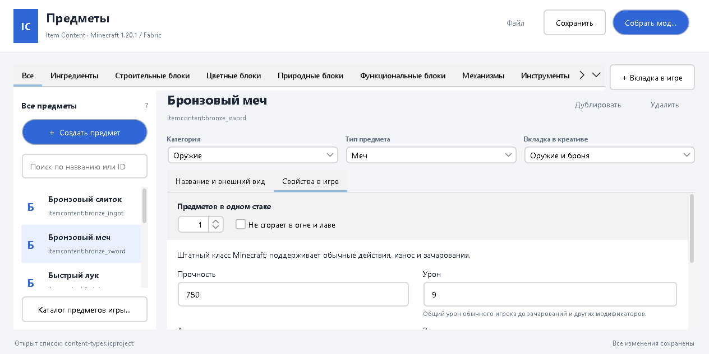

# Item Content

**Item Content** — редактор для создания предметов и блоков и сборки собственных модов для **Minecraft 1.20.1 / Fabric**.
Он разработан для проекта [Item Parameters](https://github.com/stimkerru-creator/item-parameters-minecraft)
и может использоваться отдельно.

В редакторе задаются название, тип, игровые свойства и текстуры. Программа сохраняет настройки
и собирает готовый JAR с выбранными предметами, моделями и текстурами. Для создания предметов не нужно писать код.
Игрокам нужен ваш JAR и обычная среда Fabric с Fabric API; редактор и игровой Item Content им не нужны.

## Скачать и запустить

**[Скачать готовый редактор для Windows x64 — Java уже включена](https://github.com/stimkerru-creator/item-content-fabric/releases/latest/download/item-content-1.4.1-windows-x64.zip)**

Распакуйте **весь архив** в удобную папку и откройте **run-editor.bat**.
Устанавливать Java, Gradle или собирать проект не нужно. Кнопка GitHub **Code → Download ZIP**
скачивает исходники для разработчиков; готовая программа находится в **[Releases](https://github.com/stimkerru-creator/item-content-fabric/releases/latest)**.

## Возможности

- Сборка самостоятельного мода JAR: только отмеченные предметы и их ресурсы.
- Свои название, версия и ID мода; разные наборы можно установить вместе.
- Создание слитков, компонентов и других обычных предметов.
- Создание еды, мечей, луков, арбалетов, инструментов и брони с настраиваемыми свойствами.
- Создание обычных блоков с настройкой внешнего вида, прочности, освещения и условий добычи.
- Импорт моделей Minecraft Java из JSON, ZIP или папки ресурс-пака: геометрия, текстуры, родительские модели, анимация текстур и модели состояний предмета.
- Простые PNG-текстуры, отдельные текстуры граней блока и текстуры брони.
- Просмотр предметов Minecraft и установленных модов, создание новых предметов на их основе.
- Изменение поддерживаемых свойств существующих предметов.
- Выбор вкладок креатива и создание собственных вкладок.
- Подключение новых типов предметов через API расширений.

## Как пользоваться

1. Скачайте готовый Windows-комплект, распакуйте его и запустите **run-editor.bat**.
2. Нажмите **Создать предмет**, выберите его тип и задайте название.
3. Выберите **Модель Minecraft → Импортировать модель…** для своей модели или **Простая текстура** для обычной картинки. Настройте свойства во вкладке **Свойства в игре**.
4. Нажмите **Сохранить**, затем **Собрать мод…**. Задайте название и ID мода и отметьте нужные предметы.
5. Нажмите **Собрать JAR…** и сохраните готовый файл. В мод попадут только отмеченные строки, а не весь каталог игры.

Примеры типов находятся в `examples/content-types.icproject`, готовый пример объёмных предметов — в `examples/native-models.icproject`, исходные ресурсы моделей — в `examples/minecraft-models`.
Подробные действия с примерами описаны в [инструкции редактора](docs/editor.md).

## Установка готового мода

1. Установите Fabric Loader и Fabric API для Minecraft 1.20.1.
2. Положите собранный JAR в папку `mods`. Для сетевой игры тот же файл нужен на сервере и клиентах.
3. Запустите игру. Предметы появятся в выбранных вкладках креатива, модели и текстуры подключатся автоматически.

Редактор, исходный `.icproject`, каталог из тысяч предметов, отдельный Item Content,
конфиги и ручное включение ресурс-пака для готового мода не нужны.
Например, из списка 4000 предметов можно отметить 200 — только эти 200 войдут в мод.

Для старых рабочих сборок сохранён режим **Файл → Установить рабочий список через Item Content…**.
Это отдельный способ предварительной проверки; для распространения используйте **Собрать мод…**.

## Совместимость

Мод предназначен для **Minecraft 1.20.1 с Fabric**. Созданные предметы можно использовать
в рецептах и системах других модов, которые работают с обычными предметами Minecraft.

Для особой механики сторонних модов предусмотрен [API расширений](docs/extensions.md).
Самостоятельная сборка поддерживает встроенные типы Minecraft. Произвольный код сторонних
провайдеров автоматически не переносится: редактор сообщает об этом до сборки.
Если используете чужие предметы, исходный мод остаётся необходимой зависимостью.

## Документация

- [Работа с редактором](docs/editor.md)
- [Настройки и форматы файлов](docs/configuration.md)
- [API расширений](docs/extensions.md)
- [Сборка из исходников](docs/development.md)
- [Результаты проверок](docs/validation.md)
- [История изменений](CHANGELOG.md)

Лицензия проекта — [MIT](LICENSE). Используемые библиотеки и их лицензии перечислены
в [THIRD-PARTY-NOTICES.txt](THIRD-PARTY-NOTICES.txt).
