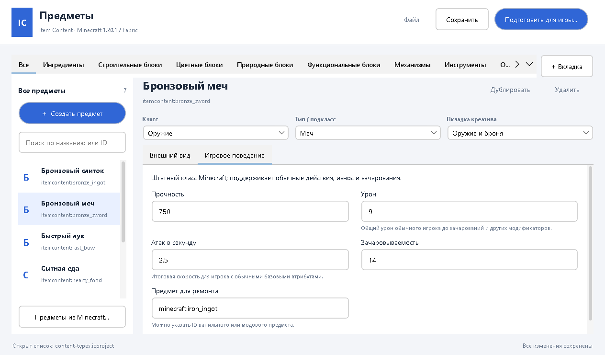

# Item Content

Конструктор предметов и простых блоков для **Minecraft 1.20.1 / Fabric**. В отдельном редакторе
вы задаёте название, изображение, тип и игровые свойства, затем готовите файлы для игры.
Писать Java или JSON для встроенных типов не требуется.

Поддерживаются слитки и компоненты, еда, мечи, кирки, топоры, лопаты, мотыги, луки, арбалеты,
броня, обычные блоки, декоративные сундуки и печи. Сундуки и печи в этом выпуске — устанавливаемые
декорации без инвентаря и производственной логики. Сторонние расширения могут добавлять свои типы
и редактируемые свойства через [открытый API](docs/extensions.md).

## Запуск

Распакуйте **item-content-1.2.0.zip** целиком и запустите **run-editor.bat**. Нужна Java 17+.
Готовый выпуск включает редактор, Fabric-мод, примеры, инструкции и лицензии; JDK и Gradle не нужны.
На Linux/macOS: `java -jar lib/item-content-editor-1.2.0.jar`.

Из исходников тот же запускатель использует `editor/build/libs`; если сборки нет, требуется JDK
и доступ к репозиториям зависимостей. [Сборка и тесты](docs/development.md).

## Первый предмет

1. Откройте **Файл → Открыть список предметов… → examples/content-types.icproject**.
2. Выберите «Бронзовый меч». Сверху видны **Класс: Оружие**, **Тип: Меч** и вкладка креатива.
3. Во **Внешнем виде** измените имя, ID, PNG или модель. В **Игровом поведении** задайте урон,
   скорость атаки и прочность. Это обычные свойства Minecraft, одинаковые для всех экземпляров этого ID.
4. **Сохранить** записывает редактируемый список. **Подготовить для игры…** создаёт папку установки.
5. Установите Fabric Loader, Fabric API и мод из `mods` на сервер и каждый клиент.
   Скопируйте экспортированные `config/item-content` в их `config`; определения должны совпадать.
6. На клиентах включите `resourcepacks/item-content`. Если экспорт содержит `datapacks/item-content`,
   положите его в `datapacks` каждого нужного мира. Перезапустите игру и сервер.
7. Предметы появятся в выбранных вкладках. Получение примера: `/give @s itemcontent:bronze_sword`.

Каждое действие с примерами: **[инструкция редактора](docs/editor.md)**.

## Уже существующие предметы

Войдите в мир с установленными модами. Каталог создаётся в фоне; команда **/itemcontent catalog**
обновляет его вручную и сообщает путь после завершения. Откройте этот `config/item-content/catalog.json`
в редакторе кнопкой **Предметы из Minecraft…**. Доступны поиск, реальные вкладки креатива, свойства,
копирование и настройка существующего предмета. Простые PNG-модели получают иконки.

У исходного предмета сохраняются ID и Java-класс. Редактируются общие настройки и свойства,
которые поддерживает его тип/расширение. Остальные показаны для справки и создания нового предмета.
Специальная механика модов не копируется автоматически из произвольного Java-класса.

## Независимость и совместимость

Item Content работает самостоятельно. Он не требует Item Parameters, не создаёт его каталоги,
не рассчитывает формулы и не добавляет индивидуальные массивы числовых параметров.
Его предметы доступны другим системам как обычные зарегистрированные предметы Minecraft.

Новые ID создаются в собственном пространстве `itemcontent`, без пула заглушек и без замены чужих ID.
Режим настройки существующих предметов включается отдельно и сохраняет исходную регистрацию.
Для новых типов другого мода нужен установленный поставщик поведения: сам мод или отдельный аддон.
Обязательной зависимости от какого-либо оружейного или магического мода нет.

Создание предмета само по себе не добавляет добычу, крафт или рецепт станка. Идентификаторы
не следует менять после выпуска: сохранения мира ссылаются именно на них.

## Документация

- [Редактор: предметы, поведение, картинки, вкладки и установка](docs/editor.md)
- [Форматы для разработчиков](docs/configuration.md)
- [Добавление типов и интеграций](docs/extensions.md)
- [Соответствие требованиям и границы](docs/requirements-audit.md)
- [Проверки](docs/validation.md), [разработка](docs/development.md), [миграция](docs/migration.md)
- [Лицензии библиотек](THIRD-PARTY-NOTICES.txt), [история изменений](CHANGELOG.md)

Текущие ограничения: 4096 определений в одном списке, 4 МиБ настроек, PNG до 4096×4096 и 16 МиБ.
Это защитные пределы, а не обещание производительности произвольной сборки модов.
