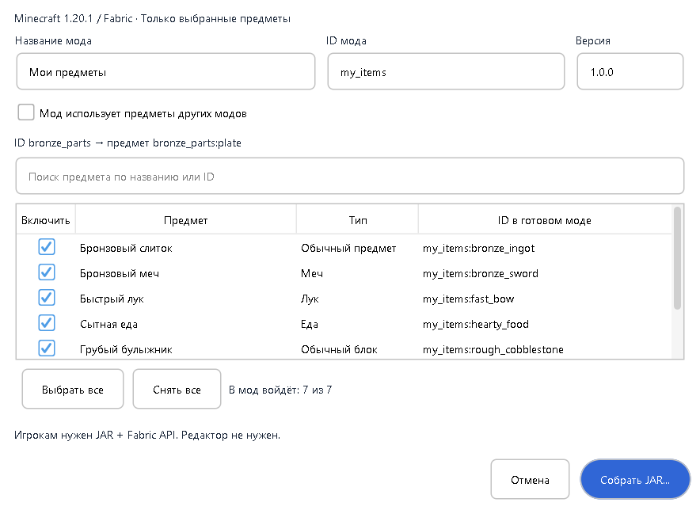

# Редактор: пошаговая инструкция

Редактор работает отдельно от Minecraft. Скачайте **Windows x64 (Java включена)** из Releases, распакуйте весь архив и запустите **run-editor.bat**. Установка Java для этого комплекта не нужна.
Готовый результат — самостоятельный мод JAR с выбранными предметами. Для его сборки не нужны JDK, Gradle или интернет.
Игрокам не требуются редактор и Item Content: код регистрации, модели и текстуры включены в JAR.

Редактор открывается в одном окне. Повторный запуск поднимает это окно; перед открытием другого
списка редактор предлагает сохранить изменения. Повторное открытие текущего списка сохраняет
ваши несохранённые правки в окне.

## Собрать и раздать свой мод



1. Создайте нужные предметы и сохраните список.
2. Нажмите **Собрать мод…**.
3. **Название мода** — текст для людей, например «Бронзовые детали».
4. **ID мода** — его постоянное имя латиницей, например `bronze_parts`. Предмет `plate`
   получит адрес `bronze_parts:plate`. Таблица сразу показывает итоговые ID. Для обновления
   уже выпущенного мода сохраняйте этот ID и имена предметов: они записаны в мире.
5. **Версия** — например `1.0.0`; при выпуске обновления её можно увеличить.
6. Галочками выберите состав. **Снять все** очищает выбор; поиск помогает найти нужные строки.
   Счётчик показывает, сколько войдёт в мод. Из списка 4000 можно включить только 200.
   Выбор и сведения о моде сохраняются вместе со списком при нажатии **Сохранить**.
7. Если предмет использует ресурсы другого вашего предмета или нужен ему для ремонта, отметьте
   и этот предмет. Редактор укажет недостающую ссылку; весь каталог автоматически не добавляется.
8. Если нужны предметы стороннего мода, включите **Мод использует предметы других модов** и
   укажите ID необходимых модов через запятую. Эта строка задаёт зависимости, а не переносит чужой код.
9. Нажмите **Собрать JAR…**, выберите место и имя нового файла. Существующие файлы не заменяются.
10. Установите полученный JAR в `mods` Minecraft 1.20.1 / Fabric вместе с Fabric API.
    Для сервера и клиентов используйте один и тот же JAR. Модели, текстуры и правила добычи
    подключатся автоматически, ресурс-пак вручную включать не нужно.

Редактор, файл списка, рабочий Item Content и его настройки не передаются игрокам.
Внутри JAR есть `ITEMS.txt` с итоговыми ID; например `/give @s bronze_parts:plate`.
Разные моды с разными ID можно использовать вместе. В каждый включён необходимый игровой код;
общую вложенную библиотеку загрузчик Fabric использует один раз. Она не содержит каталога
из 4000 предметов и не требует отдельной установки.

Собираются встроенные типы: обычный предмет, еда, оружие, инструменты, броня и поддерживаемые блоки.
Специальный сторонний provider нельзя перенести простым копированием его настроек. Такой тип
отклоняется с объяснением, а не заменяется молча обычным предметом.
Декоративные сундуки и печи при самостоятельной сборке по-прежнему декоративные.

Ниже примеры создания предметов. В примерах готовый мод называется `bronze_parts`.

## Где что находится

- **Слева**: ваш список, поиск, создание предмета; снизу — каталог установленных в игре предметов.
- **Над карточкой**: категория, тип предмета и вкладка в креативе.
- **Название и внешний вид**: название, ID и выбор текстуры.
- **Свойства в игре**: размер стака, огнестойкость и свойства выбранного типа. У меча это урон и прочность, у еды — голод и насыщение.
- **Сверху окна**: сохранить список и **Собрать мод…**. Открытие и сохранение копии находятся в меню **Файл**.

В компактном окне карточка прокручивается вертикально; верхние вкладки креатива прокручиваются стрелками.
Предпросмотр показывает текстуру либо иконку выбранного образца. Трёхмерный вид модели проверяется в игре.

### Как подключить собственную модель Minecraft

1. В карточке предмета выберите **Модель Minecraft**.
2. Нажмите **Импортировать модель…**.
3. Укажите один из вариантов:
   - **JSON-модель Java Block/Item** и её PNG рядом с ней — например, результат экспорта из Blockbench;
   - **ZIP ресурс-пака Minecraft Java** или **JAR с ресурсами мода**;
   - **папку ресурс-пака**, в которой находится `assets`.
4. Для ресурс-пака выберите нужную модель из списка. Поле поиска отбирает модели по имени.
5. После успешного импорта сохраните список и нажмите **Собрать мод…**.

Редактор сам собирает связанные текстуры, файлы анимации `.png.mcmeta`, родительские модели
и модели состояний предмета (`overrides`). Положение в руке, геометрия и развёртка остаются из модели.
Файлы сохраняются **внутри `.icproject`**: при переносе списка исходный ресурс-пак больше не нужен.
В игре они становятся обычными ресурсами Minecraft, без замены предметов исходного ресурс-пака.

**Пример без написания файлов:** создайте предмет с именем «Бронзовая деталь», выберите тип
**Обычный предмет**, нажмите **Модель Minecraft → Импортировать модель…**, откройте папку
`examples/minecraft-models` из комплекта и выберите `sample:item/component`.
Соберите JAR и положите его в `mods`. У предмета будет собственная объёмная
модель с анимированной текстурой. Для устанавливаемого в мире объекта выберите тип **Обычный блок**
и импортируйте ту же модель: она будет видна и в инвентаре, и после установки.

Предпросмотр редактора показывает **текстуру модели**, а не её объёмную форму.
Проверяйте итоговый 3D-вид в Minecraft. Файл `.bbmodel` сначала экспортируйте из Blockbench
как **Java Block/Item**; исходники Bedrock/GeckoLib требуют другого загрузчика и здесь не импортируются.

### Два других способа задать внешний вид

**Простая текстура → Выбрать PNG-файл…** подходит для слитка, еды, простого меча или кубического блока.
PNG — штатный формат текстур Minecraft. Редактор создаёт для неё простую модель выбранного типа.
Если у вас уже есть полноценная JSON-модель, используйте **Модель Minecraft**, чтобы сохранить её форму.

**Как у предмета из игры → Выбрать предмет…** позволяет взять готовое оформление установленного предмета.
Выберите папку своей сборки Minecraft, затем найдите предмет в каталоге по названию.
Искать PNG внутри файлов игры и вводить ID модели не нужно.
Тип и игровые действия своего объекта задавайте отдельно в **Свойства в игре**.
При открытии старого списка ранее выбранный способ сохраняется.

## 1. Слиток или другой обычный предмет

1. Нажмите **Создать предмет**. Для первого предмета можно использовать уже созданную карточку.
2. **Категория → Предметы**, **Тип предмета → Обычный предмет**.
3. В **Название в игре** напишите `Бронзовый слиток`. Это текст для игрока.
4. В **ID предмета** после `itemcontent:` напишите `bronze_ingot`.
   В списке получится `itemcontent:bronze_ingot`. При сборке мода с ID `bronze_parts`
   его игровой адрес станет `bronze_parts:bronze_ingot`. Он используется в сохранениях и рецептах.
   Можно оставить предложенное `item_1`; имена не должны повторяться.
5. Выберите **Простая текстура** и нажмите **Выбрать PNG-файл…**. Выберите PNG слитка.
   Если хотите использовать готовый вид медного слитка, переключитесь на **Как у предмета из игры**
   и через **Выбрать предмет…** найдите медный слиток. Это необязательно.
6. Во вкладке **Свойства в игре** задайте **Предметов в одном стаке → 64**.
   Над карточкой выберите **Вкладка в креативе → Ингредиенты**.

Результат: новый настоящий предмет. Команда после сборки и установки: `/give @s bronze_parts:bronze_ingot`.
Крафт, добыча и числовые характеристики отдельных экземпляров этим действием не назначаются.

Русским может быть название. ID использует строчные латинские буквы, цифры и `_`.
Не меняйте выпущенные ID: ранее сохранённые предметы ссылаются на них.

## 2. Меч, инструмент, лук, броня

Пример меча:

1. Создайте предмет, назовите `Бронзовый меч`, ID `bronze_sword`.
2. Выберите **Категория → Оружие → Тип предмета → Меч**. Стак автоматически станет 1.
3. В **Название и внешний вид** выберите **Простая текстура** и выберите PNG своего меча.
   Выбирать железный меч не требуется.
4. Откройте **Свойства в игре** и введите:

| Поле | Пример | Что изменится |
|---|---:|---|
| Прочность | 750 | Запас обычной прочности до поломки |
| Урон | 9 | Общий урон обычного игрока с этим мечом до прочих модификаторов |
| Атак в секунду | 2.5 | Обычная скорость атаки |
| Зачаровываемость | 14 | Штатная настройка наложения зачарований |
| Предмет для ремонта | minecraft:copper_ingot | Материал для ремонта в наковальне |

Результат: `SwordItem` Minecraft с выбранными настройками, а не обычный предмет с названием «меч».
Урон дополнительно зависит от брони цели, критического удара, зачарований и других игровых эффектов.

**Категория → Инструменты** даёт кирку, топор, лопату или мотыгу. Помимо урона и прочности доступны
скорость и уровень добычи. Уровень работает с тегами блоков; они включаются в собранный JAR.

**Оружие → Лук**: настройте прочность и время полного натяжения в тиках. `20` — одна секунда,
`10` — половина секунды при нормальной скорости игры. Используются обычные стрелы и механики зачарований.
**Арбалет** использует штатную зарядку Minecraft; отдельного поля скорострельности у встроенного арбалета нет.

**Броня → Броня**: выберите часть комплекта, прочность, защиту, твёрдость, сопротивление отбрасыванию,
зачаровываемость и материал ремонта. Иконка предмета и текстура надетой брони — разные изображения.
Для собственной текстуры надетой брони выберите `custom` в её настройке и обе PNG через
**Название и внешний вид → Другие текстуры… → Броня: слой 1 / слой 2**. Используйте штатную развёртку брони Minecraft.

Обычные числа вводятся с точкой или запятой. Формул в этом редакторе нет: их задаёт другой мод.

## 3. Еда

1. **Создать предмет → Категория: Еда → Тип предмета: Еда**.
2. Название `Сытный хлеб`, ID `hearty_bread`. Добавьте PNG своего хлеба.
   Если нужна готовая картинка хлеба Minecraft, выберите её через **Как у предмета из игры → Выбрать предмет…**.
3. В **Свойствах в игре** задайте восстановление голода `8`, коэффициент насыщения `0.6`.
4. При необходимости включите «Можно есть сытым», «Быстро съедается» или кормление волков.

Результат: еду можно съесть; она восполняет голод по штатным правилам Minecraft.
Это настройка типа предмета, а не индивидуальный массив характеристик.
Собственные эффекты зелий у новой еды базовый тип пока не настраивает; их может добавить расширение.

## 4. Обычные блоки и декоративные модели

1. **Создать предмет → Категория: Блоки → Тип предмета: Обычный блок**.
2. Например: название `Грубый булыжник`, ID `rough_cobblestone`. Добавьте свою PNG камня
   либо выберите булыжник в **Как у предмета из игры → Выбрать предмет…**.
3. В **Свойствах в игре** задайте твёрдость `2`, взрывоустойчивость `6`, свет `0`, звук `stone`,
   инструмент `pickaxe`, требуемый уровень `1` — каменная кирка.
4. Для своей текстуры выберите основную PNG. Она покрывает все грани.
   **Другие текстуры…** позволяют отдельно заменить верх, низ, бок, перед и зад.
5. Соберите мод и установите его JAR в `mods`. Правила добычи включаются в JAR автоматически.

Результат: блок можно поставить и сломать. Он выпадает сам собой при подходящей добыче.
В **Свойствах в игре → Скрывать грани соседних блоков** выберите:

- **Автоматически**: обычная модель куба скрывает соседние грани, импортированная модель и декоративный сундук — нет.
- **Полный непрозрачный куб**: для сплошного блока, включая импортированный кубический булыжник. Скрытые грани соседей не рисуются.
- **Не скрывать соседние грани**: для опор, решёток и другой неполной геометрии. Сквозь пустые части видны соседние блоки.

Автоматический режим не анализирует точную форму и прозрачность произвольной импортированной модели.
Для импортированного полного непрозрачного куба выберите этот режим вручную.
Это настройка отрисовки, а не формы столкновений: у обычного блока коллизия остаётся кубической.

Выбор инструмента и требуемого уровня работает через стандартные теги Minecraft.
При уровне `0` подходящий инструмент ускоряет добычу, но блок может выпасть и без него.

**Декоративный сундук** имеет форму сундука с крышкой и замком, поворачивается при установке,
но не открывается и не хранит предметы. Без собственной PNG использует доски дуба;
для бронзового вида выберите свою металлическую PNG. Поле модели для этой геометрии не используется.
**Декоративная печь** имеет ориентируемую переднюю сторону, но не плавит и не имеет инвентаря.
Рабочую печь/сундук или другую сложную механику должен предоставить отдельный тип расширения.

## 5. Добавить текстуры

**Выбрать PNG-файл…** включает **Простая текстура** и показывает картинку с прозрачностью.
Основная PNG: до 4096×4096 и 16 МиБ, например 16×16 или 32×32. Экспорт содержит её копию.
В режиме **Как у предмета из игры** образец выбирается из каталога.
Выбор стрелы для меча изменит его оформление, но не сделает его боеприпасом: механика остаётся механикой меча.

PNG лука/арбалета получает штатную модель в руках. Через дополнительные текстуры можно задать
три стадии натяжения; у арбалета также заряженную стрелу и фейерверк. Без отдельных кадров используется основная PNG.
Текстуры надетой брони задаются отдельно от PNG иконки.

В режиме **Простая текстура** список `.icproject` хранит **пути к исходным PNG**. Импортированная **Модель Minecraft** вместе со связанными ресурсами хранится внутри списка. При переносе списка на другой ПК переносите картинки
или выбирайте их заново. Собранный JAR уже содержит самостоятельные копии.

## 6. Каталог настоящей игры и существующие предметы

1. Запустите Minecraft с Item Content и нужными модами, войдите в мир.
2. Дождитесь выгрузки каталога. Для обновления введите **/itemcontent catalog**.
   Команда сообщает путь после завершения, например `<папка игры>/config/item-content/catalog.json`.
3. В редакторе нажмите **Каталог предметов игры…** и выберите папку этой сборки, где находятся `mods` и `config`.
   Редактор найдёт каталог сам; выбирать `catalog.json` и искать PNG в файлах игры не нужно.
4. В открывшемся окне ищите по названию, ID или имени мода в ID. Вкладки сверху соответствуют вкладкам этой игры.
   Справа видны доступные свойства и возможность их изменения.
5. **Создать новый на основе…** создаёт самостоятельный ID `itemcontent:…_copy`.
   **Настроить существующий** добавляет карточку исходного ID в ваш список.

Иконки извлекаются из доступных PNG-моделей. Сложные рендереры, анимированные текстуры и
специальные объекты могут не иметь точного предпросмотра. Это не мешает поиску по имени/ID.

У существующего предмета сохраняются ID, класс и исходная механика. Можно изменить название,
размер стака, огнестойкость и разрешённые типом поля: например, прочность меча или настройки еды.
Затемнённые поля справочные: встроенный тип не изменяет урон исходного меча или твёрдость исходного блока.
Сторонний тип может явно разрешить дополнительные настройки через свой API.
Если сторонний предмет имеет стак больше 99, он доступен для просмотра; настройка такой записи пока не поддерживается.
PNG существующего блока меняет его **иконку предмета**; текстуры установленного чужого блока этот режим не редактирует.

Копирование на основе предмета переносит только поддерживаемые настройки. Оно не копирует произвольный
Java-класс, NBT-варианты, специальные эффекты или механику чужого мода. Без известного расширения
неподдерживаемые значения берутся из настроек нового встроенного типа и могут отличаться от исходника.

## 7. Вкладки креатива

В поле **Вкладка в креативе** выберите нужную категорию. Верхние вкладки редактора фильтруют ваш список.
Новая вкладка также регистрируется в игре. Назначьте ей хотя бы один предмет, включите его в собранный мод
и перезапустите Minecraft — тогда вкладка будет видна в креативе.
Предмет из списка слева можно перетащить на вкладку сверху. **+ Вкладка** создаёт собственную категорию:
задайте название для игрока и уникальное латинское ID.

В каталоге игры перетаскивание предмета на вкладку создаёт настройку его перемещения в вашем списке.
Перемещение применяется после экспорта, установки и перезапуска; открытая игра от редактора не изменяется.
При перемещении исходный предмет удаляется из прежних категорий и добавляется в выбранную.
«Сохранить исходные вкладки» оставляет прежнее расположение.
У предметов с NBT-вариантами перемещение заблокировано, чтобы не потерять варианты в креативе.

## 8. Сохранить и собрать мод

**Сохранить / Ctrl+S** сохраняет весь список в `.icproject`; **Файл → Сохранить список как…** — отдельную копию.
**Дублировать** создаёт независимую карточку с новым ID. **Удалить** убирает карточку после подтверждения.
Поиск не стирает предметы: очистите его, чтобы снова увидеть все.

**Собрать мод…** открывает выбор предметов и сохраняет готовый JAR, как описано в начале инструкции.
При обновлении мода сохраните прежний ID, увеличьте версию и замените старый JAR новым
на сервере и клиентах. Не устанавливайте обе версии одного мода одновременно.

## Дополнительно: прежний режим рабочего списка Item Content

Этот режим нужен для существующих рабочих сборок. Для самостоятельного распространения
используйте **Собрать мод…**. Следующие действия требуют установки исходного Item Content
и отдельного набора ресурсов; они не требуются игрокам вашего собранного мода.

### Установить в свою игру

1. Установите Minecraft 1.20.1, Fabric Loader и Fabric API. Полностью закройте игру и сервер.
2. Выберите **Файл → Установить рабочий список через Item Content…**.
3. Укажите корневую папку нужной сборки. На Windows предложен `%APPDATA%\.minecraft`,
   обычно `C:\Users\<имя>\AppData\Roaming\.minecraft`. Если лаунчер использует свою папку, выберите её.
   Нужна папка, внутри которой находятся `mods`, `config` и `resourcepacks`, а не одна из этих подпапок.
4. В окне показаны конкретные пути. Мод будет в `mods`, определения предметов — в
   `config/item-content/items.json`, текстуры — в `resourcepacks/item-content`.
   JAR берётся из полного комплекта Item Content. Fabric и Fabric API редактор не скачивает.
5. Если для блоков настроены правила добычи, выберите существующий мир: его папка содержит `level.dat`.
   Для одиночной игры он обычно находится в `<папка игры>/saves/<мир>`; для сервера — в папке его мира.
   Редактор установит только свой набор правил в `<мир>/datapacks/item-content`.
6. Нажмите **Установить в выбранную игру**. Прежние настройки, набор ресурсов и заменяемые версии мода
   сохраняются в `.item-content-backups` выбранной игры. Резервная копия набора правил мира хранится
   в `.item-content-backups` самого мира; файл `paths.txt` в основной копии перечисляет пути восстановления.
7. Запустите Minecraft, включите набор ресурсов **Item Content** и откройте креатив.
   В сетевой игре установите тот же список на сервер и на каждого клиента.

Установка заменяет прежний список Item Content выбранным списком: держите все нужные предметы вместе.
Каталог игры, остальные моды и содержимое мира не заменяются. При ошибке записи установщик
пытается восстановить прежние файлы; если восстановление не завершилось, показывает путь резервной копии.

### Экспортировать для другого ПК или сервера

**Файл → Экспортировать файлы для переноса… → новая или пустая папка** создаёт комплект:

```text
экспорт/
├─ config/item-content/items.json      # предметы, свойства и вкладки креатива
├─ resourcepacks/item-content/         # текстуры и модели
├─ datapacks/item-content/             # если нужны правила добычи блоков
└─ INSTALL.txt
```

Это экспорт, а не установка. При ручной установке положите JAR Item Content и Fabric API в `mods`;
перенесите настройки в `config` сервера и клиентов, набор текстур в `resourcepacks` клиентов,
а набор правил — в `datapacks` нужного мира. Включите набор текстур и полностью перезапустите игру и сервер.
Занятая папка экспорта не перезаписывается.

Изменение свойств, предметов и вкладок требует перезапуска. Обновлённые PNG можно перечитать через `F3+T`.
Пример команды: `/give @s itemcontent:rough_cobblestone`.

## 9. Сторонние типы

Если установленный мод или аддон предоставляет расширение Item Content, его типы и поля
попадают в каталог игры. Откройте свежий каталог: тип появится в списках **Категория / Тип предмета**,
а его поля — в **Свойствах в игре**. Например, поставщик может дать «Автомат» и «Скорострельность».
Самого универсального JSON с именем Java-класса недостаточно для подключения чужой механики.
Подключение пишет автор расширения один раз; пользователь затем работает в форме без кода.

Прямых интеграций с Таумкрафтом или конкретным оружейным модом этот выпуск не устанавливает.
[API для авторов расширений](extensions.md). [Миграция прежних списков](migration.md).

## Возможности и границы импорта моделей

Поддерживается формат моделей **Minecraft Java 1.20.1**: `parent`, `elements`, `textures`, ссылки `#`,
`display`, `gui_light`, `ambientocclusion`, `overrides` и PNG с `.mcmeta`.
Условия `overrides` работают, когда выбранный тип предмета предоставляет соответствующее условие;
например, встроенные лук и арбалет поддерживают свои штатные состояния использования.
Ресурсы другого мода нужно включить в импортируемый комплект; ссылки на стандартные ресурсы
Minecraft 1.20.1 редактор распознаёт сам.

Импорт модели задаёт **внешний вид**, а не Java-класс. Инвентарь сундука, обработка печи,
новые свойства состояния блока и особые рендереры требуют соответствующего типа расширения.
Файл `blockstates` из чужого ресурс-пака не создаёт новые состояния блока автоматически:
редактор формирует его для выбранного типа блока. Геометрия модели также не меняет его коллизию.

До экспорта проверяются отсутствующие ресурсы, циклы `parent` и недопустимые пути.
Одна импортированная модель может включать до **512 файлов**; суммарно в одном списке — до **32 МиБ**
импортированных ресурсов. Каждая PNG — до **4096×4096** и **16 МиБ**.
Список редактора версии 3 открывает прежние версии 1/2; обновлённый список нужно открывать новым редактором.

Описание формата: [модели предметов в документации Fabric](https://wiki.fabricmc.net/tutorial:items).


### Обновление правил добычи

Если меняете инструмент добычи, убираете требование инструмента или удаляете блок из списка,
при установке выберите тот же мир, куда ставили прежние правила. Редактор заменит только свой
набор `datapacks/item-content`, а предыдущую версию сохранит в `.item-content-backups` мира.
Для нескольких миров повторите установку с каждым миром. При ручном переносе заменяйте
папку `datapacks/item-content` целиком, даже когда новый набор содержит только `pack.mcmeta`:
копирование поверх старых файлов оставит удалённые правила.

Папки установки и экспорта не должны проходить через Windows junction или символические ссылки.
Если редактор сообщает об этом, выберите обычную папку по её фактическому пути.
